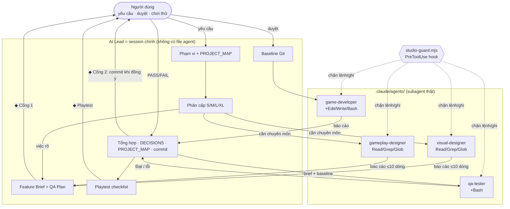
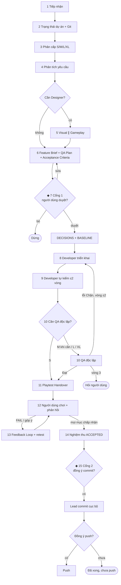
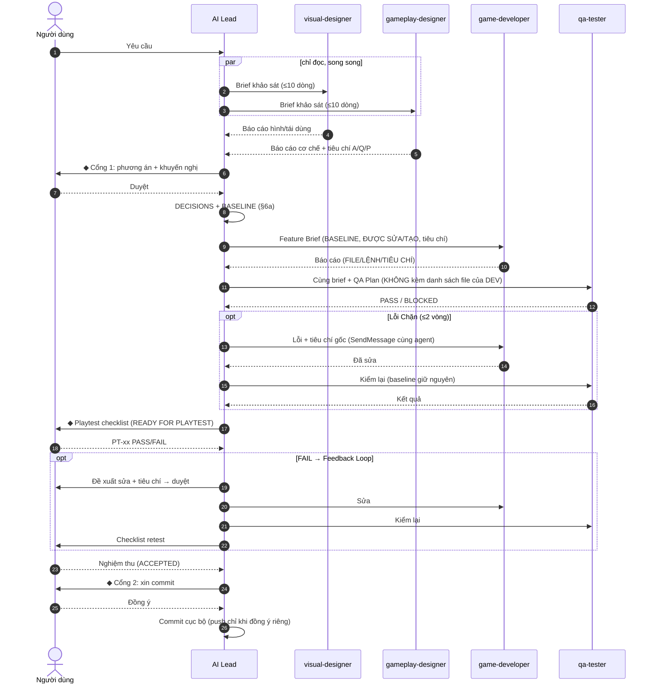
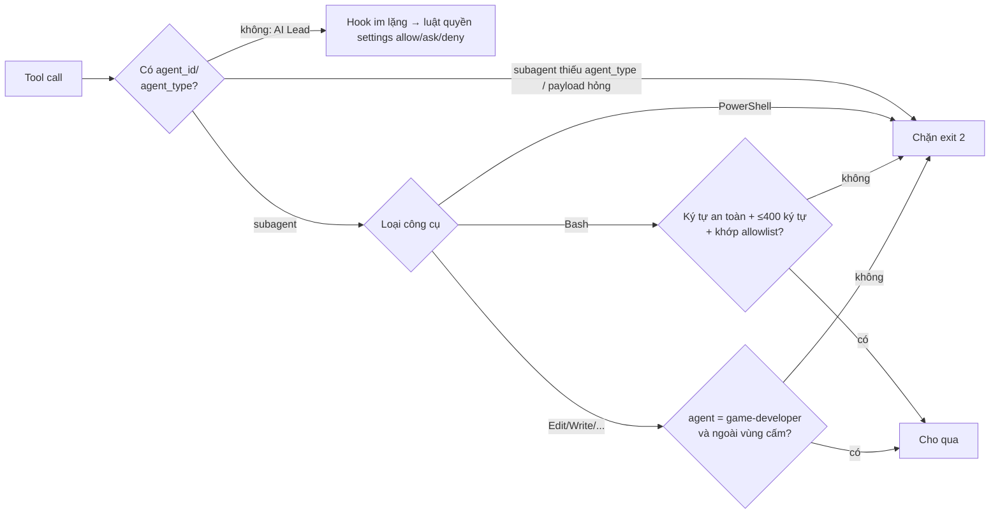
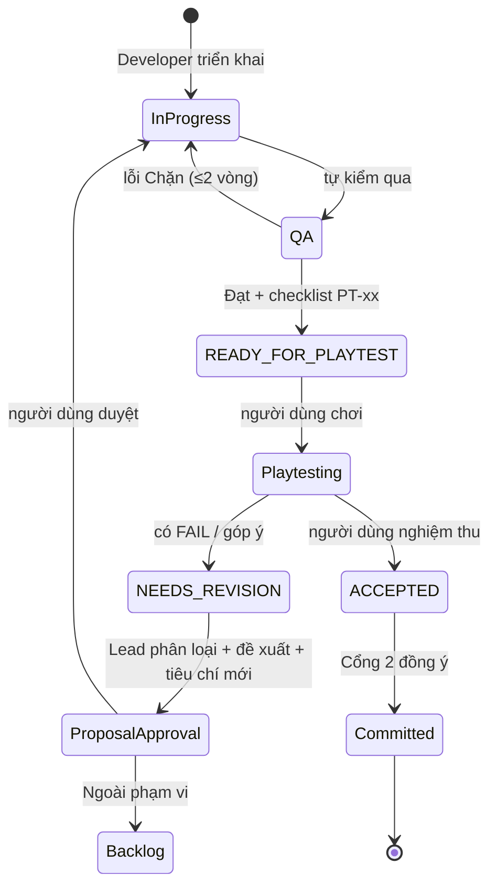

# AI STUDIO PROCESS MAP — Bản đồ quy trình AI Studio (Pixel World)

Tài liệu **tổng quan, chỉ mô tả** quy trình hiện hành; không thay thế và không sửa luật. Nguồn sự thật vẫn là `docs/studio/WORKFLOW.md` (§1–§12), `CLAUDE.md`, `.claude/agents/*.md`, `.claude/settings.json`, `.claude/hooks/studio-guard.mjs`. Khi tài liệu này lệch với nguồn, **nguồn thắng**.
Lập: 2026-11-17 (AI Lead, nhiệm vụ phân tích; không sửa code/cấu hình).
**Cập nhật ST-01 (2026-11-17):** thêm Task Map (`CURRENT_TASK.md`, `tasks/`, `TASK_HISTORY.md`), Codebase Map 3 cấp (`docs/PROJECT_MAP.md` + `docs/codemap/`), bộ mẫu `docs/studio/templates/` và WORKFLOW §0, §13. Luồng 15 bước ở §4 giữ nguyên; Task Map được tạo ở bước 1–4 và cập nhật sau mỗi bước (WORKFLOW §13.1). Điểm T1, T5, T6, T7 ở §9.4 đã xử lý.

Nhãn dùng trong tài liệu:
- **[CẤU HÌNH]**: có trong file cấu hình harness và được harness thi hành (đã đọc file).
- **[ĐÃ XÁC MINH]**: đã chạy kiểm chứng trong phiên lập tài liệu (lệnh + kết quả nêu kèm).
- **[GIẤY]**: chỉ là quy định trong tài liệu/prompt; thi hành nhờ agent tuân thủ, không có cơ chế ép.
- **[MEMORY]**: nằm trong memory cá nhân của Claude (`~/.claude/projects/.../memory/`), **không** nằm trong repo.

---

## 1. Sơ đồ tổng thể

Mô hình **hub-and-spoke** (WORKFLOW đầu tài liệu, §1): subagent **không gọi nhau**; mọi bàn giao đi qua AI Lead.

---

## 2. Thực tế cấu hình vs quy định trên giấy

| Thành phần | Có thật trong cấu hình? | Ở đâu | Ghi chú |
|---|---|---|---|
| AI Lead | **Không có file agent** — là vai của session chính | `CLAUDE.md` mục 9–10, WORKFLOW §1 | [GIẤY] Hook bỏ qua Lead (cuộc gọi không có `agent_type`) |
| visual-designer | Có | `.claude/agents/visual-designer.md`, tools: Read, Grep, Glob | [CẤU HÌNH] công cụ; hook chặn thêm Bash/ghi |
| gameplay-designer | Có | `.claude/agents/gameplay-designer.md`, tools: Read, Grep, Glob | [CẤU HÌNH] |
| game-developer | Có | `.claude/agents/game-developer.md`, tools: Read, Grep, Glob, Edit, Write, Bash | [CẤU HÌNH] ghi được; hook giới hạn Bash + vùng cấm |
| qa-tester | Có | `.claude/agents/qa-tester.md`, tools: Read, Grep, Glob, Bash | [CẤU HÌNH] hook giới hạn Bash, chặn ghi |
| Hook `studio-guard` | Có | `.claude/settings.json` → PreToolUse `Bash\|PowerShell\|Edit\|Write\|NotebookEdit\|MultiEdit`, `onFailure: block` | [ĐÃ XÁC MINH] `node --test .claude/hooks/studio-guard.selftest.mjs` → 29/29 pass |
| Luật quyền allow/ask/deny | Có | `.claude/settings.json` (+ `.claude/settings.local.json` cá nhân) | [CẤU HÌNH] `git clean` deny; add/commit/push/reset/checkout/restore/stash/rebase/merge/branch -D = ask |
| Skills dự án | **Không** | không có `.claude/skills/` | — |
| CI / git hooks | **Không** | không có `.github/`, `.git/hooks` chỉ có mẫu | Kiểm build/test hoàn toàn do agent chạy tay |
| Lean S/M/L/XL | Giấy | WORKFLOW §12 (duyệt 2026-11-17) | [GIẤY] Lead tự phân cấp |
| Báo cáo ≤10 dòng | Giấy | WORKFLOW §12.3, `templates/AGENT_REPORTS.md` | [GIẤY] file agent trỏ tới mẫu (ST-01) |
| Feature Brief + QA Plan | Giấy | mẫu `templates/FEATURE_BRIEF.md`; brief thật `lean-handoff/*_FEATURE_BRIEF.md` | [GIẤY] |
| Task Map / Codebase Map | Giấy | `CURRENT_TASK.md`, `tasks/`, `TASK_HISTORY.md`; `PROJECT_MAP.md` + `docs/codemap/` (WORKFLOW §0, §13) | [GIẤY] Lead cập nhật; lỗi thời phát hiện bằng dòng "Kiểm lỗi thời" |
| Baseline Git + QA kiểm phạm vi | Giấy (QA tự chạy git) | WORKFLOW §6a | Hook **không** kiểm danh sách ĐƯỢC SỬA/ĐƯỢC TẠO |
| Playtest Handover | Giấy + memory | WORKFLOW §9a–9b, §12.5; memory `playtest-handover-workflow` | [GIẤY]/[MEMORY] checklist ở `docs/studio/playtests/` |
| Chế độ tự chủ | Giấy | WORKFLOW §14 (ST-02); memory `autonomous-work-protocol` chỉ trỏ về §14 | [GIẤY] |
| Token log | Giấy | `lean-handoff/TOKEN_LOG.md`, §12.7 | Chỉ số subagent; số session chính chưa từng có |

---

## 3. Bảng vai trò Agent

### 3.1 AI Lead (session chính — vai, không phải file agent)
| Mục | Nội dung |
|---|---|
| Mục tiêu | Điều phối, giữ phạm vi, làm việc với người dùng, giữ Knowledge Base |
| Được làm | Mọi công cụ (theo luật quyền settings); phân cấp; viết brief; lập baseline; tự sửa việc nhỏ (S/1 file); ghi `DECISIONS.md`, `PROJECT_MAP.md`, catalog; xóa file tạm trong ĐƯỢC TẠO sau QA; commit khi được đồng ý |
| Không được | Tự duyệt thay người dùng; bỏ cổng; tự đổi cân bằng/cấu hình quyền; đánh PASS playtest thay người dùng; push khi chưa đồng ý |
| Đầu vào | `CLAUDE.md`, `WORKFLOW.md` (đọc đầu mỗi phiên, CLAUDE.md mục 10), `PROJECT_MAP.md`, `DECISIONS.md`, memory |
| Đầu ra | Phương án Cổng 1, Feature Brief + QA Plan, dòng BASELINE, mục DECISIONS, checklist playtest, báo cáo 5 dòng (§11) |
| Giao tiếp | Người dùng ↔ Lead ↔ từng subagent |

### 3.2 Bốn subagent

| | visual-designer | gameplay-designer | game-developer | qa-tester |
|---|---|---|---|---|
| **Vai trò** | Phân tích/đề xuất hình ảnh Pixel Art, animation, VFX, tái dùng asset | Phân tích/đề xuất cơ chế, skill, cân bằng, tiến trình | Triển khai thiết kế đã duyệt | Kiểm thử độc lập, báo lỗi |
| **Mục tiêu chính** | Đề xuất hình phù hợp phong cách, ưu tiên tái dùng | Đề xuất + **tiêu chí nghiệm thu kiểm chứng được** | Code đúng thiết kế, đúng danh sách file | Xác nhận tiêu chí + phạm vi bằng bằng chứng |
| **Được làm** | Read/Grep/Glob | Read/Grep/Glob | Read/Grep/Glob/Edit/Write; Bash trong allowlist hook | Read/Grep/Glob; Bash trong allowlist hook |
| **Không được** | Sửa/tạo file; tự quyết; bịa dữ kiện; hard-code số | Sửa file; hard-code số; thiết kế hình; tự quyết | Làm khi brief thiếu 1 trong 5 điều kiện; sửa ngoài 2 danh sách; vùng cấm; commit/push; refactor tiện tay; lách hook | Sửa code; tạo/xóa file; dùng danh sách file của Developer làm sự thật; khẳng định hành vi runtime khi chỉ đọc code |
| **Đầu vào** | WORKFLOW, `ASSET_CATALOG.md`, `assets/README.md`, `ASSET_NAMING.md`, `ANIMATION_GUIDE.md`, `VFX_GUIDE.md`, PROJECT_MAP | WORKFLOW, `DECISIONS.md`, PROJECT_MAP, `CLASS_REDESIGN.md`, `CLASS_EXPANSION.md`, `src/config/` | Brief (mục tiêu · "đã duyệt" · BASELINE · ĐƯỢC SỬA/TẠO · tiêu chí), WORKFLOW, CLAUDE.md, PROJECT_MAP | Brief/QA Plan, BASELINE, 2 danh sách nguyên văn, WORKFLOW |
| **Đầu ra** | Phạm vi / Hiện trạng / Tái dùng / Đề xuất / Rủi ro (≤10 dòng theo brief) | Phạm vi / Hiện trạng / Đề xuất / File ảnh hưởng / Tiêu chí A-Q-P / Rủi ro | FILE · LỆNH (build/tsc/test) · TIÊU CHÍ · LỆCH · CHƯA KIỂM · CẦN LEAD | Mục E QA Plan: PASS/BLOCKED, theo ID, phạm vi từ git, lỗi theo mẫu, chưa kiểm được |
| **Bàn giao cho** | Lead | Lead | Lead (→ QA) | Lead (→ Developer nếu lỗi, → người dùng nếu Đạt) |
| **Khi gọi** | Asset/hình/VFX/phong cách mới; người dùng gửi hình tham khảo | Cơ chế/skill/cân bằng/tiến trình mới | Có thiết kế **đã duyệt** + brief đủ | Sau mọi thay đổi cấp L/XL; cấp M khi tiêu chí không tự kiểm bằng máy |
| **Khi không gọi** | Việc chỉ tái dùng asset đã rõ; để "xác nhận" việc đã rõ (§12.2) | Việc kỹ thuật thuần, tham số đã chốt | Chưa duyệt; việc quá nhỏ Lead tự làm | Cấp S (Developer/Lead tự kiểm) |

---

## 4. Quy trình chi tiết 15 bước

| # | Bước | Ai | Làm gì | Đọc gì | Đầu ra | Điều kiện sang bước sau | Người dùng? |
|---|---|---|---|---|---|---|---|
| 1 | Tiếp nhận | Lead | Ghi nhận yêu cầu, xác định là tính năng/sửa lỗi/tài liệu | `WORKFLOW.md` (đầu phiên), memory | Câu phát biểu phạm vi | Hiểu yêu cầu; mơ hồ thì hỏi | Có (nguồn yêu cầu) |
| 2 | Trạng thái + Git | Lead | `git status`, HEAD, nhánh; xem việc dở trong `DECISIONS.md` | `DECISIONS.md` (mục trên cùng) | Biết cây sạch/dơ, việc đang chờ | Không có việc dở xung đột (hoặc đã hỏi) | Chỉ khi cây dơ cần quyết (§6a.2) |
| 3 | Phân cấp | Lead | Chọn S/M/L/XL; rủi ro cao ⇒ ≥ L (§12.1) | WORKFLOW §12.1 | Cấp ghi vào brief | — | Có thể đổi cấp bất cứ lúc nào |
| 4 | Phân tích | Lead | Tra `PROJECT_MAP` "Tìm file…", Grep/đọc theo offset | `PROJECT_MAP.md`, file liên quan | Danh sách file/hệ thống ảnh hưởng | Đủ để viết brief hoặc biết cần Designer | Không |
| 5 | Thiết kế | visual / gameplay designer (song song, chỉ đọc) | Hiện trạng có `file:dòng`, đề xuất, tiêu chí | Theo §3.2 | Báo cáo ≤10 dòng | Lead xử lý mâu thuẫn (§7: tài liệu duyệt > người dùng > Designer; cơ chế trước hình) | Không (trừ câu hỏi chọn phương án) |
| 6 | Feature Brief + AC | Lead | Viết một brief dùng chung cho Developer và QA: mục tiêu, tham chiếu, ĐƯỢC SỬA/TẠO, KHÔNG đụng, thiết kế, tiêu chí A (xác định) / Q (QA độc lập) / P (chơi thật), QA Plan A–D | Báo cáo Designer, mẫu `lean-handoff/` | `lean-handoff/<ID>_FEATURE_BRIEF.md` | Brief đủ ý | Không |
| 7 | **Cổng 1** | Người dùng | Duyệt / sửa / bỏ (việc nhỏ: một câu xác nhận) | Phương án + khuyến nghị + đánh đổi | Lời duyệt; Lead ghi `DECISIONS.md` | Có lời duyệt rõ | **Bắt buộc** (chế độ tự chủ: chỉ bỏ cho bước kỹ thuật, không bỏ cho thiết kế mới) |
| 8 | Triển khai | game-developer (hoặc Lead nếu S rất nhỏ) | Lead lập **BASELINE** (§6a) rồi giao; Developer sửa đúng 2 danh sách | Brief, WORKFLOW, CLAUDE.md, PROJECT_MAP | Diff trong working tree | Hoàn tất hoặc DỪNG (cần file ngoài danh sách → Lead cập nhật brief, báo người dùng) | Không |
| 9 | Tự kiểm | game-developer | `npm run build`, `npx tsc --noEmit`, `npm test`, đọc `git diff`; tự sửa ≤2 vòng | — | Báo cáo Developer (FILE/LỆNH/TIÊU CHÍ/LỆCH/CHƯA KIỂM/CẦN LEAD) | Lệnh qua | Không |
| 10 | QA độc lập | qa-tester | HEAD = baseline; `git diff --name-status HEAD` + untracked mới − mẫu baseline; phân loại phạm vi; tiêu chí A/Q; hồi quy mục C | Brief/QA Plan, BASELINE, 2 danh sách nguyên văn | Mục E: PASS/BLOCKED | Không còn lỗi Chặn. Lỗi → Developer sửa, QA kiểm lại, **tối đa 2 vòng**, vòng 3 hỏi người dùng | Chỉ ở vòng 3 hoặc khi chấp nhận lỗi không chặn |
| 11 | Playtest Handover | Lead | Viết `docs/studio/playtests/<ID>_*.md`: ID PT-xx ổn định, một hành vi/mục, thao tác, mong đợi, PASS/FAIL/NOT TESTED; cách chạy (`npm run dev`, điều kiện, URL params); giới hạn; mẫu phản hồi. Nhãn **READY FOR PLAYTEST** | Tiêu chí P, mục "chưa kiểm được" của QA | Checklist + tin nhắn bàn giao | Đã gửi; Lead dừng chờ | **Có** |
| 12 | Chơi thử | Người dùng | Chơi, báo từng mục | Checklist | `PT-xx: PASS / FAIL — …` | Có kết quả | **Có** |
| 13 | Feedback Loop | Lead (+Designer chỉ đọc nếu cần) → người dùng duyệt → Developer → QA → người dùng | Phân loại: Lỗi / Chỉnh thông số / Đổi thiết kế / Ngoài phạm vi; đề xuất + tiêu chí mới; checklist kiểm lại chỉ mục bị ảnh hưởng + hồi quy | Code liên quan | Bản sửa + checklist retest; nhãn NEEDS REVISION → READY FOR PLAYTEST | Người dùng duyệt đề xuất (§9b.4; thông số nhỏ gộp một câu) | **Có** |
| 14 | Nghiệm thu | Người dùng | Xác nhận đạt | — | Nhãn **ACCEPTED**; `DECISIONS.md` "đã triển khai, đã nghiệm thu" | Người dùng nói rõ | **Bắt buộc** |
| 15 | Commit / push | Lead | Cổng 2: xin đồng ý → commit cục bộ (kèm Co-Authored-By); cập nhật PROJECT_MAP/catalog; báo cáo 5 dòng + "đã xong" | §11 | Commit SHA ghi vào `DECISIONS.md` | Đồng ý commit; push là **đồng ý riêng** | **Bắt buộc** |

---

## 5. Sơ đồ bàn giao giữa Agent

---

## 6. Cơ chế phối hợp

| Câu hỏi | Quy định | Thi hành |
|---|---|---|
| Lead gọi agent thế nào? | Công cụ Agent với `subagent_type` = tên file agent; brief tự đủ ý vì subagent không nhớ hội thoại (§6); hỏi tiếp cùng phạm vi bằng `SendMessage` tới agent cũ (§12.3) | [GIẤY] |
| Tuần tự hay song song? | Song song: việc chỉ-đọc độc lập (2 Designer); nhiều Developer chỉ khi tập file không giao nhau. Tuần tự: Designer → duyệt → Developer → QA. File lớn dùng chung luôn tuần tự (§3) | [GIẤY] |
| Tránh hai agent sửa cùng file | Chỉ `game-developer` ghi được (hook); hai danh sách trong brief; Developer song song không trùng file (§8) | Hook [CẤU HÌNH] cho "ai được ghi"; **trùng file giữa hai Developer không có cơ chế ép** |
| Chuyển giao kết quả | Báo cáo ≤10 dòng theo `templates/AGENT_REPORTS.md` → Lead đọc, cập nhật Task Map → Lead viết brief tiếp. Không agent nào đọc báo cáo của agent khác trực tiếp | [GIẤY] |
| QA phát hiện lỗi | Mẫu: Mức · Bước · Thực · Mong đợi · File. Lead chuyển Developer kèm tiêu chí gốc; QA kiểm lại phần lỗi + build/test + phạm vi; baseline và 2 danh sách giữ nguyên (§9) | [GIẤY] |
| Số vòng tự sửa | Developer tự sửa ≤2; vòng sửa sau QA ≤2; vòng 3 Lead dừng, hỏi người dùng. Vòng Feedback Loop **không** tính vào trần này (§9b) | [GIẤY] |
| Khi gọi Designer | Chỉ khi cần chuyên môn thật (§12.2); tính năng có cả hình lẫn cơ chế → cả hai song song (§2) | [GIẤY] |
| Khi QA độc lập | L/XL luôn; M khi tiêu chí không tự kiểm bằng máy hoặc vùng hồi quy liên quan; S không (§12.1, §12.4) | [GIẤY] |
| Kiểm soát token | Không đọc toàn dự án; PROJECT_MAP + Grep + offset; một brief dùng chung; báo cáo ≤10 dòng; không 2 agent phân tích cùng thứ; SendMessage thay agent mới; ghi số thật vào `TOKEN_LOG.md` (§12.3, §12.7) | [GIẤY]; số liệu subagent có thật trong `TOKEN_LOG.md` |

### Lớp cưỡng chế của hook (đã đọc mã, self-test 29/29)

Allowlist Bash subagent: `npm test`, `npm run build`, `npx tsc --noEmit`, `npx vitest run --root . [src/**.test.ts]`, git chỉ-đọc (`status`, `diff`, `log`, `show`, `ls-files`, `rev-parse`, `hash-object`, `branch --show-current`). Vùng cấm ghi: `.claude/`, `CLAUDE.md`, `docs/studio/DECISIONS.md`, `.git/`, `package*.json`, `tsconfig*.json`, `vite.config.*`, `.env*`, `.gitignore`, `node_modules/`, `dist/`.

---

## 7. Ma trận S / M / L / XL

| | **S** | **M** | **L** | **XL** |
|---|---|---|---|---|
| Dùng khi | ≤ ~2 file, rõ, không rủi ro cao | 1 hệ thống, ≤ ~5 file, tiêu chí rõ | Nhiều file/hệ thống **hoặc rủi ro cao** | Tính năng lớn, đổi kiến trúc, nhiều gói |
| Lead | Có thể tự làm | Brief, quyết có gọi QA (ghi lý do) | Brief + QA Plan đầy đủ | Điều phối, chia gói (vd P3a/b/c, P4a/b) |
| Designer | Không | Hiếm | Khi cần | Khi cần |
| Developer | Subagent hoặc Lead | Có | Có | Có, từng gói |
| Tự kiểm (tsc/test/build + diff) | **Bắt buộc** | Bắt buộc | Bắt buộc | Bắt buộc |
| QA độc lập | Không | **Khi cần** | **Bắt buộc**, §6a đầy đủ | **Bắt buộc** từng gói |
| Baseline Git | Chỉ khi giao subagent (một dòng) | Có | Có | Có, mỗi gói |
| Cổng 1 | Một câu xác nhận | Gọn | Đầy đủ | Đầy đủ, theo gói |
| Playtest | Khi có thay đổi chơi được | Có nếu ảnh hưởng gameplay/hình | **Bắt buộc** | **Bắt buộc**, từng gói |
| Cổng 2 | Một câu | Có | Có | Có, mỗi gói commit riêng |
| Có thể bỏ | QA, Designer, brief dài | Designer, QA (nếu máy kiểm đủ) | Designer (nếu đã rõ) | — |

Rủi ro cao ⇒ luôn ≥ L: `WorldScene.ts`/`CharacterPanelScene.ts`; save/`progression/`; `combatConfig.ts`, `enemyConfig.ts`; `.claude/` hoặc hook; kiến trúc đã duyệt; đổi tên/di chuyển hàng loạt.
Thực tế lịch sử: mọi gói P2→P4b đều chạy cấp **L** (hoặc L/XL), vì đụng `WorldScene.ts` (`TOKEN_LOG.md`).

---

## 8. Playtest và Feedback Loop

- **Checklist** (`docs/studio/playtests/<ID>_<tên>.md`): trạng thái, baseline, "đã kiểm tự động (không cần kiểm lại)", "chưa kiểm được bằng máy", cách chạy, bảng `ID · Kiểm · Thao tác · Mong đợi · Kết quả`, giới hạn nói thẳng, mẫu phản hồi. Ví dụ: `P4b_withered_woods.md`.
- **Phân loại phản hồi (§9b.1):** Lỗi · Chỉnh thông số (`src/config/`) · Đổi thiết kế (ghi DECISIONS) · Ngoài phạm vi.
- **Retest:** checklist mới chỉ gồm mục bị ảnh hưởng + hồi quy.
- **Không bao giờ**: Lead đánh PASS thay người dùng; tuyên bố đạt phần hình/cảm giác khi chưa xác nhận.
- Lịch sử cho thấy chấp nhận cả nghiệm thu không kèm từng mục (P3b) và mục NOT TESTED (P3a 8/10) — do người dùng quyết.

---

## 9. Đánh giá quy trình hiện tại

### 9.1 Đã cấu hình và đang hoạt động
- 4 subagent có file định nghĩa và giới hạn công cụ.
- Hook `studio-guard` ép quyền ở tầng harness, fail-closed; self-test 29/29 đạt (2026-11-17).
- Luật quyền: `git clean` deny; lệnh git ghi ở mức ask.
- Lịch sử thật: P2→P4b đều có brief, baseline, QA Đạt, checklist playtest, mục DECISIONS, commit sau nghiệm thu (`DECISIONS.md`, `TOKEN_LOG.md`, `docs/studio/playtests/`).

### 9.2 Chỉ có trên giấy, chưa có cơ chế ép
- Phân cấp S/M/L/XL, giới hạn báo cáo ≤10 dòng, trần 2 vòng sửa, cổng duyệt, kiểm phạm vi ĐƯỢC SỬA/TẠO (QA làm tay), "Developer song song không trùng file".
- Playtest Handover và chế độ tự chủ phần lớn nằm ở **memory** (không trong repo); máy/phiên khác hoặc người khác không thấy.

### 9.3 Chưa có quy định
- **Push**: chỉ có "không push khi chưa đồng ý"; không có thủ tục (kiểm gì trước khi push, push lúc nào). Hiện mọi commit P3d/P4a "chưa push".
- **Nhánh**: mọi việc làm thẳng trên `main`; WORKFLOW không quy định nhánh tính năng (system prompt chung có "branch first", repo không theo).
- **Nhiều gói chưa commit chồng nhau**: không có luật cấm bắt đầu gói mới khi gói trước chưa commit (đã xảy ra: P4a bắt đầu khi P3d chưa commit → baseline ngoại lệ).
- **Kiểm runtime tự động**: không có test trình duyệt/e2e; QA không chạy game; công cụ trình duyệt có sẵn trong môi trường nhưng chưa dùng.
- **Hết hạn checklist**: không quy định việc gì xảy ra nếu người dùng không playtest (gói treo READY FOR PLAYTEST).

### 9.4 Trùng lặp / mâu thuẫn
| # | Điểm | Chi tiết |
|---|---|---|
| T1 ✅ ST-01 | File agent lệch Lean §12 | `qa-tester.md` vẫn mô tả báo cáo dài (5 mục, dán đầu ra); `game-developer.md` chỉ yêu cầu `npm test` "nếu có logic thuần" trong khi §12 yêu cầu tự kiểm tsc/test/build. Đã ghi là "điểm còn mở" trong `DECISIONS.md` (mục Lean) |
| T2 ✅ ST-02 (WORKFLOW §6a "tài liệu Lead") | Baseline "tracked sạch" | §6a yêu cầu sạch, ngoại lệ chỉ khi người dùng chỉ thị rõ + hash từng file. Brief P4b ghi "tracked sạch (trừ tài liệu Lead sửa song song)" — một dạng ngoại lệ **chưa có trong §6a** |
| T3 | Trần 2 vòng | Lặp ở §4, §9.4, §12.3, file agent — đồng nhất nội dung nhưng 4 chỗ phải sửa cùng lúc |
| T4 ✅ ST-02 (WORKFLOW §14) | Chế độ tự chủ vs Cổng | Memory nói "không xin duyệt từng bước"; WORKFLOW §5 yêu cầu Cổng 1 cho mọi thiết kế mới. Memory tự giới hạn (thiết kế mới vẫn qua Cổng 1) nhưng WORKFLOW không nhắc chế độ này → người đọc repo không biết ranh giới |
| T5 ✅ ST-01 | Mẫu "thử nghiệm" | `REPORT_TEMPLATE.md`, `QA_PLAN_TEMPLATE.md` tiêu đề còn "(thử nghiệm)" dù §12 đã duyệt |
| T6 ✅ ST-01 | Brief + QA Plan | Mẫu tách hai file (`M4_FEATURE_BRIEF.md` + `M4_QA_PLAN.md`); thực tế từ P2 gộp một file "FEATURE BRIEF + QA Plan" |
| T7 ✅ ST-01 | Đọc WORKFLOW mỗi lần | Cả 4 file agent bắt đọc toàn `WORKFLOW.md` (~200 dòng) ở bước 0 — mâu thuẫn mục tiêu tiết kiệm token §12.3 |

### 9.5 Rủi ro
| Mức | Rủi ro | Ghi chú |
|---|---|---|
| Cao | `.claude/settings.local.json` cho phép `Bash(python -)` và `Bash(npm test *)` | Áp cho Lead (hook bỏ qua Lead): `python -` = chạy mã tùy ý qua stdin không hỏi. Không ảnh hưởng subagent (hook vẫn chặn) |
| Cao | Không ép "người dùng đã duyệt" | Developer chỉ kiểm brief **có dòng** "đã duyệt"; Lead tự viết dòng đó. Toàn bộ cổng dựa vào kỷ luật của Lead |
| TB | Gói chưa commit tích lũy | Nhiều gói dơ cùng lúc làm baseline phức tạp, rủi ro mất việc nếu chạy lệnh git sai (đặc biệt nếu mở phiên với `--dangerously-skip-permissions`, bỏ cả mức ask) |
| TB | Phụ thuộc memory | Quy tắc tự chủ/playtest handover không nằm trong repo |
| TB | Không kiểm runtime | Lỗi chỉ lộ khi chơi (hình ảnh, va chạm, hiệu năng mobile) dồn hết sang người dùng |
| Thấp | Hook không sandbox | Developer vẫn có thể viết mã chạy qua `npm test`/`build` (đã ghi ở §8); QA diff là lớp phát hiện |
| Thấp | Self-test hook chạy tay | Không có CI; đổi hook mà quên chạy self-test thì không ai phát hiện |

### 9.6 Đề xuất cải thiện (chưa làm — cần Cổng 1 vì đụng `.claude/` hoặc WORKFLOW)
1. ✅ **Đã làm ở ST-01.** **Đồng bộ file agent với §12** (T1, T7): giới hạn 10 dòng, dùng `REPORT_TEMPLATE.md`; bước 0 chỉ đọc mục WORKFLOW liên quan (vd Developer: §6, §6a, §8; QA: §6a, §9, §12.4).
2. ✅ **Đã làm ở ST-02.** **Bổ sung §6a** ngoại lệ "tài liệu do Lead sửa song song" (danh sách mẫu đường dẫn chỉ `docs/**`, ghi hash) cho khớp thực tế (T2).
3. ✅ **Đã làm ở ST-02 (§14).** **Thêm mục "Chế độ tự chủ" vào WORKFLOW** (tóm tắt từ memory, ranh giới với Cổng 1/2) để quy trình nằm trong repo (T4).
4. **Quy định push + nhánh**: vd "mỗi gói L/XL một nhánh hoặc commit ngay sau nghiệm thu; push theo lô sau khi build/test qua và người dùng đồng ý".
5. **Luật "một gói chưa commit tại một thời điểm"** trừ khi người dùng chỉ thị khác.
6. **Gỡ `Bash(python -)`** khỏi `settings.local.json` (hoặc thu hẹp), cân nhắc thay `Bash(npm test *)` bằng dạng chính xác.
7. **Một bước smoke test runtime** tùy chọn (mở `npm run dev` + công cụ trình duyệt, chụp màn hình, đọc console) để bắt lỗi đỏ trước khi giao playtest — giảm tải PT "Console sạch".
8. ✅ **Đã làm ở ST-01** (`templates/FEATURE_BRIEF.md`). Gộp mẫu Brief + QA Plan thành **một mẫu** khớp thực tế (T6), bỏ chữ "thử nghiệm" (T5).
9. Thêm script `npm run guard:test` (= self-test hook) để chạy cùng QA khi đụng `.claude/`.

---

## 10. Tra cứu nhanh tài liệu nguồn
| Cần | Đọc |
|---|---|
| Luật đầy đủ | `docs/studio/WORKFLOW.md` §0–§13 |
| Nhiệm vụ đang làm + tiến độ | `docs/studio/CURRENT_TASK.md` → `docs/studio/tasks/<ID>_*.md`; đã đóng: `TASK_HISTORY.md` |
| Quyết định đã duyệt | `docs/studio/DECISIONS.md` (mới nhất trên cùng) |
| Mẫu brief/báo cáo/playtest/Task Map | `docs/studio/templates/` (bảng ở `README.md`); brief thật ở `lean-handoff/`, ví dụ `P4B_FEATURE_BRIEF.md` |
| Checklist chơi thử | `docs/studio/playtests/` |
| Token thật | `docs/studio/lean-handoff/TOKEN_LOG.md` |
| Định nghĩa agent | `.claude/agents/*.md` |
| Cưỡng chế quyền | `.claude/settings.json`, `.claude/hooks/studio-guard.mjs` (+ `studio-guard.selftest.mjs`) |
| Định vị file code | `docs/PROJECT_MAP.md` (L1) → `docs/codemap/<hệ thống>.md` (L2/L3) |
